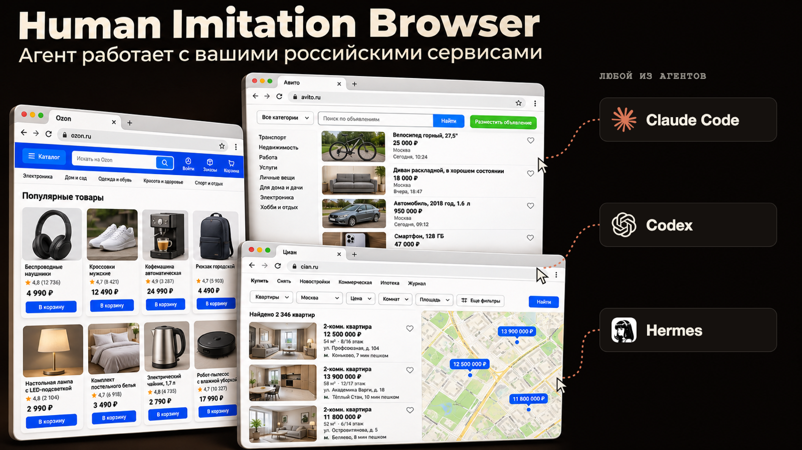

# human-imitation-browser



Настоящий браузер для вашего ИИ-агента, который открывает российские сайты – Ozon, Avito, Циан, Aviasales и похожие – с вашего сервера.

Проект от канала «Записки AI-энтузиаста» (https://t.me/dashi_agent).

## Для чего это и для чего нет

Это инструмент, через который **ваш** агент пользуется обычным браузером от вашего имени – так же, как вы сами, для ваших личных дел. Например:

- найти товар и сравнить варианты;
- посмотреть цены и объявления;
- собрать корзину или оформить заказ в своём аккаунте, когда вы об этом попросите;
- проверить цену билета.

Это не совет и не способ обходить блокировки или защиту сайтов. Если сайт показал проверку, её проходит человек. Если сайт закрыл доступ, инструмент останавливается.

**Можно:**

- пользоваться для себя и своих нужд;
- работать в своём аккаунте, в человеческом темпе;
- один профиль на одного человека. Профиль – «память» браузера, подробнее в разделе «Профиль».

**Нельзя:**

- собирать чужие персональные данные: имена, телефоны, профили, контакты из объявлений. В России это регулирует закон о персональных данных. Сбор таких данных без законного основания – нарушение, вплоть до уголовной ответственности;
- собирать объявления пачками или по расписанию, составлять из них базы, перепродавать данные;
- заходить в чужие аккаунты;
- проходить вход, платный доступ или капчу программой или через сервисы, которые решают капчи за деньги. Капча – проверка «вы не робот?»;
- заводить много аккаунтов или много профилей, чтобы выглядеть как разные люди;
- писать отзывы на заказ, накручивать оценки и как-то ещё влиять на площадку;
- следить за конкурентами для бизнеса.

Если вы продавец и работаете в своём кабинете, пользуйтесь официальным API площадки, а не браузером. API – способ, которым программа работает с сервисом напрямую. Например, у Ozon есть Seller API. Оговорка: официальную документацию Ozon (docs.ozon.ru) мы открыть не смогли – она закрыта той же защитой, что и сайт; сведения о Seller API у нас из сторонних источников.

У каждого сайта есть пользовательское соглашение – его правила. Многие из них ограничивают автоматический доступ, и аккаунт или адрес могут заблокировать.

Прочитайте правила сайта, которым пользуетесь. За то, как вы используете инструмент, отвечаете вы.

Проект не связан с Ozon, Avito, Циан, Aviasales и другими сайтами.

Это не юридическая консультация.

## Что это и для кого

ИИ-агент – программа на основе нейросети, которая сама выполняет задачи: ищет, сравнивает, собирает информацию. Например, Claude Code, Codex, Hermes или OpenClaw. Агенты обычно работают на сервере – арендованном компьютере в интернете, который включён круглосуточно.

Зачем это нужно: многие российские сайты рассчитаны на посетителей с домашним интернетом и не открываются с адресов серверов. Например, с адреса сервера Ozon показывал нашему агенту страницу с кодом 403 – «доступ запрещён».

Из чего состоит проект:

1. **Открытый браузер Camoufox на основе Firefox.** Он бесплатный, и им может управлять программа.
2. **Недорогой российский резидентный прокси.** Прокси – посредник: сайт видит не адрес вашего сервера, а адрес посредника. Резидентный – значит адрес обычного домашнего интернета в России.
   Альтернатива платному прокси – свой домашний адрес: [docs/home-proxy.md](docs/home-proxy.md). Домашний прокси без логина и пароля допустим только в закрытой сети или на самом сервере (`127.0.0.1`): на открытом адресе им сможет воспользоваться кто угодно.
3. **Ввод, похожий на человеческий:** паузы, плавные движения курсора, прокрутка страницы шагами.
4. **Проверки проходит человек.** Если сайт показал капчу, агент её не решает: он останавливается, присылает вам снимок экрана и ждёт вашего решения.

Для кого: для тех, кто запускает своего агента и хочет, чтобы тот мог посмотреть страницу на российском сайте. Опыт с ИИ и серверами не нужен – пошаговая инструкция ниже.

## Что агент сможет после настройки

- Работать как один постоянный посетитель: один и тот же браузерный профиль (куки, кэш, история), один и тот же отпечаток браузера и одна и та же сессия прокси от запуска к запуску. Сайт помнит браузер.
- Открыть страницу по адресу и подождать, пока она загрузится.
- Вести себя на странице как человек: пауза, несколько движений курсора, прокрутка вниз и обратно.
- Вернуть результат: код ответа, заголовок страницы, объём текста, снимок экрана.
- Открыть несколько страниц подряд в одном браузере с паузами между ними.
- Заметить страницу проверки или капчи, остановиться и показать её вам.

Агент не будет входить в ваши аккаунты, если вы прямо не попросите, и не будет решать капчу.

## Что проверено, а что нет

**Проверено 19 ноября 2026 года** на сервере с Ubuntu 24.04 и 8 ГБ памяти:

- Установка: `pip install camoufox[geoip]` (версия 0.5.9) в отдельном окружении Python, затем `python -m camoufox fetch`. Xvfb (виртуальный экран для браузера) был установлен.
- Запуск `Camoufox(headless="virtual", humanize=True, geoip=True, proxy=..., locale="ru-RU")` через Playwright – библиотеку для управления браузером. Запуск занимает около 10 секунд.
- Прокси: резидентный пакет mobileproxy.space, Россия, 1 ГБ. Данные прокси и остаток трафика получены через API сервиса.
- По одному заходу на каждую страницу в первой серии, без капчи:
  - главная ozon.ru – первый ответ с кодом 403, но страница отрисовалась полностью;
  - поиск на ozon.ru;
  - главная seller.ozon.ru;
  - главная avito.ru – код 439, страница отрисовалась;
  - главная cian.ru – код 200;
  - главная aviasales.ru – код 200.
- Без прокси, с адресов дата-центров (в том числе российского хостинга), Ozon отдавал страницы блокировки с кодом 403.

- Собранный `scripts/open_page.py` запускался вживую (версия без профилей, новый браузер на каждый заход). Обычная страница вернула код 200 и код завершения 0. Страница поиска на Ozon на шестом заходе за день показала пазл с ползунком: скрипт сохранил снимок экрана и завершился с кодом 3. Такую капчу по снимку не пройти – нужен живой экран, которого пока нет (см. раздел «Капча»).

**Постоянные профили – новое, и на реальных сайтах они ещё не проверены.** Мы не измеряли, как они влияют на то, как часто сайты показывают проверки. Гипотеза: постоянный посетитель вызывает меньше подозрений, чем новый браузер на каждый заход, – но это гипотеза, а не результат.

**Не проверено:**

- как часто появляются проверки при работе с постоянным профилем (см. выше);
- что отпечаток браузера и выходной адрес прокси действительно остаются теми же от запуска к запуску: код написан по документации и исходникам библиотек, но живого запуска с профилем ещё не было;
- что у нового профиля, который описывает себя как систему сервера, снимок холста (canvas) больше не подменяется: так выходит по исходникам Camoufox 0.5.9, вживую не проверяли;
- серия заходов подряд на один сайт;
- карточки товаров;
- вход в любой аккаунт;
- как человек проходит капчу и продолжает ли агент работу после неё;
- Ubuntu 22.04, другие системы, серверы с 4 ГБ памяти;
- подключение навыка к конкретным агентам;
- `HIB_PROXY_STATE` и `HIB_PROXY_CITY` – какие значения принимает сервис прокси;
- другие поставщики прокси (`HIB_PROXY_URL`).

Результат одного захода – не обещание, что так будет всегда. Сайты меняют защиту.

## Схема в 5 шагов

1. **Сервер** – любой с Ubuntu 22.04 или 24.04 и памятью от 4 ГБ (мы проверяли на Ubuntu 24.04 и 8 ГБ).
2. **Прокси** – резидентный российский пакет на mobileproxy.space и ключ доступа к его API.
3. **Установка** – одна команда: `bash scripts/install.sh`.
4. **Проверка** – `scripts/check_proxy.py`, затем `scripts/open_page.py https://www.ozon.ru/` и взгляд на снимок экрана.
5. **Подключение агента** – агент читает навык `skill/SKILL.md` и сам запускает скрипт.

## Быстрый старт

Для тех, кто уже умеет подключаться к серверу. Остальным – [полная инструкция](docs/guide.md).

```bash
git clone https://github.com/qwwiwi/human-imitation-browser.git human-imitation-browser
cd human-imitation-browser
bash scripts/install.sh
nano .env          # впишите MOBILEPROXY_API_TOKEN=ваш_ключ
.venv/bin/python scripts/check_proxy.py
.venv/bin/python scripts/open_page.py https://www.ozon.ru/
```

Профиль создаётся сам при первом запуске (имя не указано – `default`); для отдельной задачи добавьте `--profile my-shop`. Подробности – в разделе «Профиль» ниже.

Скрипт печатает одну строку с результатом, например:

```json
{"url": "https://www.ozon.ru/", "status": 403, "title": "...", "text_chars": 5120, "screenshot": "out/20261119-120000-000000-www.ozon.ru.png", "challenge": false, "reason": "", "profile": "default", "visits": 1}
```

Значения здесь – пример формата, а не результат реального запуска. Это формат JSON: так программы передают друг другу данные.

Снимок экрана лежит в папке `out/`.

## Полная инструкция

Пошагово, с объяснением каждого слова: [docs/guide.md](docs/guide.md).

## Профиль

**Профиль** – это «память» браузера: **куки** (заметки, которые сайт оставляет в вашем браузере, чтобы узнать вас), **кэш** (копии файлов страниц) и **история**. Вместе с ней профиль хранит отпечаток браузера (система, размер экрана, язык, шрифты) и номер сессии прокси, которая удерживает за профилем один и тот же выходной адрес. Всё это создаётся один раз и повторяется при каждом запуске, поэтому для сайта агент – один и тот же возвращающийся посетитель. Сайт помнит браузер.

Профиль описывает себя как ту же систему, что стоит на сервере: на сервере с Linux – Linux.

- Лежит профиль в `~/.local/share/hib/profiles/ИМЯ/` (можно изменить переменной `HIB_PROFILES_DIR`), вне папки проекта.
- **Папка профиля – фактически ключ** к сессии и ко всем аккаунтам, в которые в нём вошли. Никому её не отправляйте и не кладите в git.
- Посмотреть, показать, удалить: `scripts/profiles.py list`, `show ИМЯ`, `delete ИМЯ` (спросит подтверждение, `--yes` – без вопроса).
- **Один профиль – один настоящий владелец и его задача.** Проект не умеет создавать профили пачками и менять их по кругу, и мы не будем это добавлять: профили – не способ выглядеть как много разных людей.
- Сайт показал проверку – профиль не удаляйте и заново не создавайте: он тот же посетитель.
- Два запуска не могут работать с одним профилем одновременно (второй остановится с кодом 10). Между заходами на один сайт в одном профиле выдерживается пауза не меньше 20 секунд.
- Выходной адрес прокси может всё же смениться, когда закончилась сессия (до 120 минут – цель, а не гарантия) или отключилось устройство за прокси. Страна остаётся прежней.
- Режим `--ephemeral` – новый браузер без памяти, только для нейтральной тестовой страницы.

Подробнее – в [docs/guide.md](docs/guide.md), раздел «Профиль: один постоянный посетитель».

## Капча

Агент никогда не решает капчу сам и не пользуется сервисами, которые решают капчи за деньги.

Как это устроено:

1. Скрипт открывает страницу и проверяет, не страница ли это проверки. Признаки: заголовок вроде «Antibot Challenge Page», «Antibot Captcha», «Похоже, нет соединения» или почти пустая страница.
2. Если похоже на проверку, скрипт сохраняет снимок экрана, пишет `"challenge": true` и завершается с кодом 3.
3. Агент присылает вам снимок в ваш диалог и ждёт. Профиль при этом остаётся как был.
4. Вы решаете, что делать: попробовать позже, открыть сайт сами или отказаться от задачи.

**Пока не сделано:** передача живого экрана, когда вы решаете капчу с телефона прямо в браузере агента. Это в планах, сейчас этого нет.

## Совместимость

| Что | Статус |
|---|---|
| Ubuntu 24.04, 8 ГБ памяти | проверено |
| Ubuntu 22.04, от 4 ГБ памяти | должно работать, не проверено |
| Python | 3.10 и новее |
| Прокси | mobileproxy.space через API (на каждый профиль – своя липкая сессия); любой другой – через переменную `HIB_PROXY_URL` (`http://адрес:порт`, `http://логин:пароль@адрес:порт` или `socks5://адрес:порт` без логина), липкую сессию выбираете у поставщика сами (не проверено) |
| Агенты | любой, кто умеет запускать команды на сервере: Claude Code, Codex, Hermes, OpenClaw и похожие (подключение не проверяли) |

## Ограничения

- Camoufox сам предупреждает: «Camoufox can still be detected» – его всё равно можно распознать. Сайт может понять, что браузером управляет программа, и ограничить доступ.
- Один браузер открывает одну страницу за раз. Каждый запуск – около 10 секунд на старт браузера.
- Резидентный адрес может оказаться уже «испорченным» чужими действиями, и сайт отнесётся к нему с подозрением.
- Профиль повторяет отпечаток браузера, но не каждую мелочь: например, версия браузера обновляется вместе с ним. Профили, созданные прежними версиями проекта, сохраняют отпечаток «Windows», и на сервере с Linux библиотека заменяет у них снимок холста (canvas) случайными данными. С `HIB_PROXY_URL` (не mobileproxy.space) закрепить выходной адрес нужно самому, выбрав у поставщика липкую сессию.
- Прокси тратит трафик. Сколько уходит на одну страницу, мы не измеряли.
- Выключение картинок (`--no-images`) экономит трафик, но сам Camoufox предупреждает, что блокировка картинок может вызывать подозрения у систем защиты сайтов.

## Партнёрские ссылки

В инструкции есть партнёрские ссылки на хостинги Timeweb Cloud и AdminVPS и на сервис прокси mobileproxy.space. Каждая помечена словами «партнёрская ссылка». Если вы зарегистрируетесь по ней, автор проекта может получить вознаграждение. Можно пользоваться любым другим сервером и любым прокси с российскими адресами.

## Лицензия

MIT – см. файл [LICENSE](LICENSE). Camoufox распространяется под своими лицензиями (MPL-2.0, обёртки – MIT).
